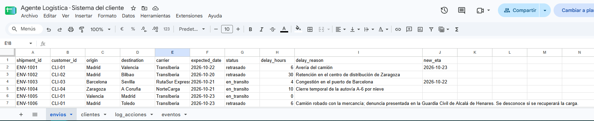
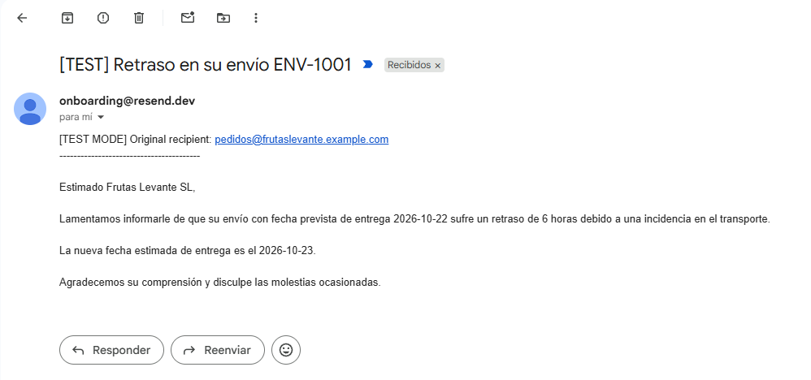
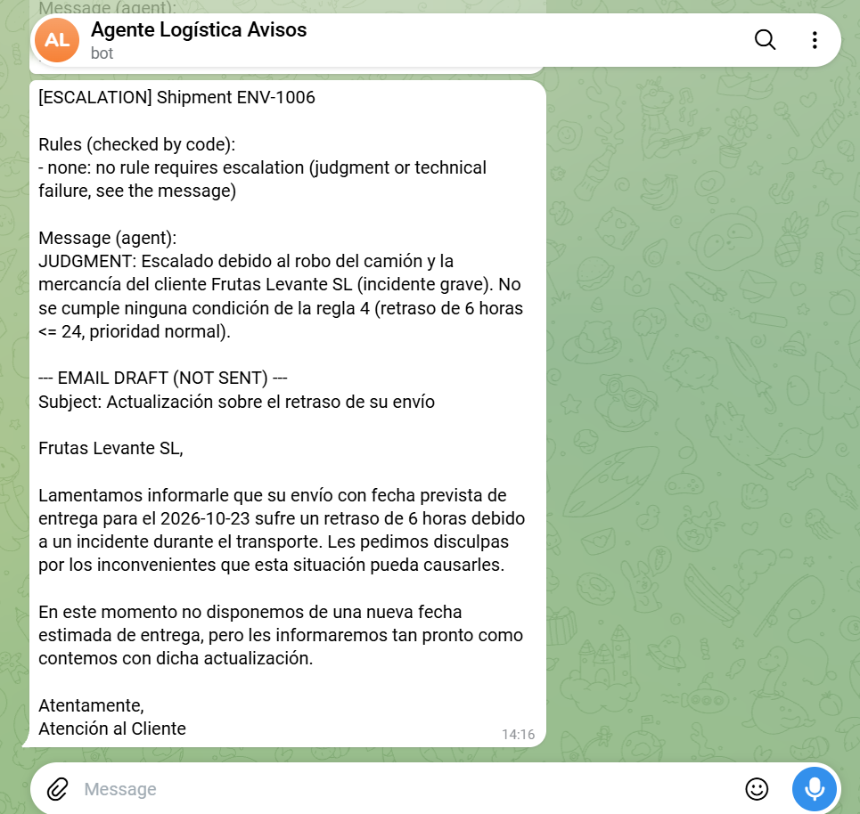
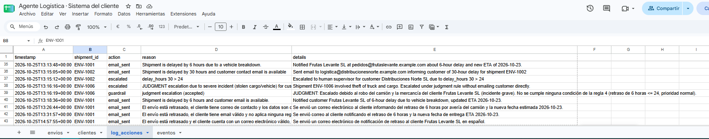
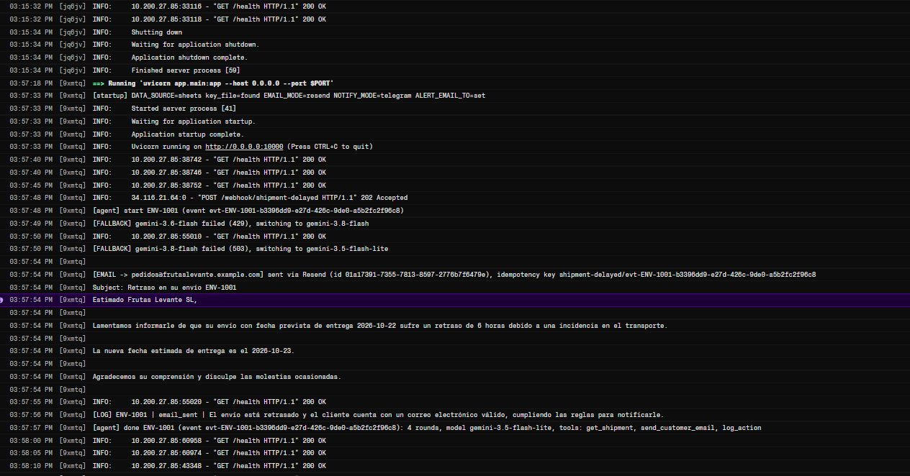
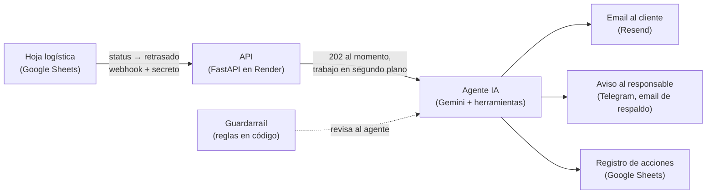

# Agente Logística — un AI worker para envíos retrasados

**Cuando un envío se marca como retrasado, un agente de IA avisa al cliente, alerta a un responsable si el caso necesita a una persona y deja registro de cada decisión. En segundos y sin nadie delante del teclado.**

[Read in English](README.md)

Proyecto personal: quería llevar un agente de IA de la idea a producción, con integraciones reales, buenas prácticas de ingeniería y un porqué claro detrás de cada decisión.

---

## Demo

### Cómo funciona, en 99 segundos

https://github.com/user-attachments/assets/d5e3231b-91da-4647-9905-36786271c4a4

Un retraso recorre todos los módulos del sistema, uno a uno. El vídeo está hecho en HTML y exportado a MP4 ([descargar](assets/viaje.mp4)); el código fuente está en [`video/`](video/). Música: Sascha Ende ([ende.app](https://ende.app/en)), CC BY 4.0.

| 1. Alguien marca un envío como `retrasado` en la hoja logística | 2. El cliente recibe un email |
|---|---|
|  |  |

| 3. Caso grave (camión robado): el agente escala con un borrador en vez de enviar el email | 4. Cada acción queda registrada |
|---|---|
|  |  |

Lo que pasa en el servidor desde que llega el aviso hasta que el agente termina (logs reales de producción):



## El problema

Imagina un operador logístico mediano. Cuando un envío se retrasa, alguien de atención al cliente tiene que darse cuenta, buscar los datos del cliente, redactar un email y, si el cliente es importante o el retraso es grave, avisar a su responsable. Es manual, lento e inconsistente: los clientes se enteran tarde (o nunca), cada persona escribe a su manera y los casos graves pueden pasar desapercibidos.

## La solución

Un agente que reacciona en cuanto un envío pasa a "retrasado":

- **Lee** los datos del envío y del cliente del sistema del operador (una Google Sheet hace ese papel).
- **Decide** qué hacer según las reglas de negocio: informar al cliente, escalar a una persona o las dos cosas.
- **Redacta** el email al cliente en su idioma, sin detalles internos y sin inventarse fechas.
- **Escala** a un responsable por Telegram cuando el retraso es largo, el cliente es prioritario, los datos están mal o pasa algo grave que las reglas no cubren (por ejemplo, un camión robado). En esos casos adjunta un borrador del email para que la persona solo tenga que revisarlo.
- **Registra** cada acción, para que cada decisión se pueda auditar.

Todos los datos son inventados (clientes y envíos ficticios). Los emails van en modo pruebas y solo llegan a mi propia bandeja.

## Cómo funciona



**Un aviso, paso a paso** (envío ENV-1001, retraso de 6 horas):

1. Alguien cambia el estado a `retrasado`. Un pequeño script de la hoja (Apps Script) envía un webhook al servidor con un secreto compartido y un `event_id` único.
2. El servidor comprueba el secreto, valida el cuerpo y mira que ese `event_id` no haya llegado antes. Responde `202` al momento, para que la hoja no espere al agente.
3. En segundo plano, el agente pide los datos del envío, aplica las reglas (6 horas y prioridad normal → solo email, sin escalar), redacta el email y registra la acción.
4. Antes de enviar, la herramienta de email vuelve a preguntar a las reglas en código: si ese email no debe salir, se niega. El email lleva una clave de idempotencia, así que un mismo aviso nunca puede enviarlo dos veces.
5. Cuando el agente termina, un guardarraíl sin LLM compara lo que hizo con las reglas. Si falta un escalado, lo hace el código; si algo no cuadra, queda registrado.

## Decisiones clave y por qué

- **El LLM decide, el código verifica.** El agente elige sus herramientas con las reglas en el prompt, y después un guardarraíl en Python (`rules.py`, la única fuente de verdad) revisa el resultado. La flexibilidad la pone el modelo y las garantías, el código. *"El prompt orienta, el código garantiza."*
- **Prevenir donde es irreversible, detectar donde se puede corregir.** Un email no se puede deshacer, así que la herramienta de email comprueba las reglas *antes* de enviar; un escalado o un registro que faltan se pueden arreglar después, y de eso se encarga el guardarraíl. En una prueba en la que se manipuló el prompt para que "enviara siempre el email", el modelo lo intentó y la herramienta se negó.
- **El modelo nunca escribe identificadores.** El id del envío y la dirección del destinatario los pone el código. En una prueba temprana el modelo "corrigió" un id; ahora sencillamente no puede.
- **Criterio con red.** Ante situaciones graves que las reglas no cubren (robo, pérdida de la mercancía, accidentes), el agente escala con un mensaje `JUDGMENT:` y un borrador en lugar de enviar el email. Esos casos se registran, así que se pueden medir, y los que se repitan pueden pasar a ser reglas.
- **Idempotencia en dos niveles.** Un webhook puede llegar dos veces (reintentos, un servidor que se despierta). El servidor recuerda cada `event_id` en la hoja, que sobrevive a los reinicios, y cada email lleva una clave de idempotencia. Un aviso → como mucho un email.
- **Responder rápido y trabajar en segundo plano.** El agente tarda segundos; quien avisa no debería esperar ni reintentar por un timeout.
- **Fallar cerrado cuando la acción es irreversible.** Sin secreto del webhook, el servidor no arranca. Emails reales sin destinatario de pruebas, el programa se para. Si no se puede comprobar si un aviso está repetido, `503` y el agente no se ejecuta. Los avisos al responsable son lo contrario: salen siempre, aunque no se puedan comprobar las reglas, porque un caso sin dueño es peor que un aviso de más.
- **Seguro por defecto.** Emails y avisos van simulados salvo que se activen; escribir a clientes reales exige un interruptor explícito que este proyecto nunca activa.
- **Los reintentos dependen de lo que cuesta un duplicado.** El email al cliente nunca se reintenta a ciegas (el duplicado lo ve el cliente); el aviso al responsable se reintenta una vez y tiene un segundo canal (email) si Telegram falla.
- **El script de la hoja recuerda qué avisó.** Google solo da el valor anterior de una celda cuando se escribe a mano, no cuando se pega. El script guarda su propio registro de qué envíos ya avisó, así que pegar encima de una celda no reenvía nada y un segundo retraso real sí avisa.
- **Comprobar la configuración al arrancar.** En la nube no hay terminal: si falta algo imprescindible, la versión nueva no arranca y la anterior sigue funcionando.

## Resultados

| Objetivo | Resultado |
|---|---|
| Funciona de punta a punta en producción, sin mi ordenador | Hoja → Render → agente → email, Telegram y registro, en casos normales, escalados y "de criterio" |
| Respuesta rápida | Menos de 10 s desde el aviso hasta el email con el servidor despierto; unos 30 s más si el plan gratuito se está despertando |
| Sin duplicados | El mismo aviso dos veces → se procesa una (comprobado en producción); pegar celdas ya no reenvía |
| Seguro con servicios reales | Modo pruebas que falla cerrado, reglas comprobadas antes de cada email, claves de idempotencia |
| Se puede probar sin gastar cuota | ~80 comprobaciones automáticas sin llamadas al LLM (Gemini, Telegram y Resend falsos) |
| Entender cada pieza | Cada fase se cerró rompiendo algo a propósito (prediciendo antes el resultado) y respondiendo preguntas de repaso |

## Limitaciones conocidas y siguientes pasos

- **Monitorización.** Telegram avisa de *casos*, no de *caídas*. Siguiente paso: un monitor externo de `/health` y alertas sobre filas `error` y `guardrail` del registro, sobre errores `429` de cuota y sobre avisos que nunca llegan a `[agent] done`.
- **Un agente cada vez.** Un candado evita que las ejecuciones mezclen estado. Siguiente paso: aislar el estado por ejecución y usar una cola de tareas con varios trabajadores.
- **El trabajo en segundo plano se pierde al reiniciar.** Si el servidor se reinicia a mitad, ese caso no se reintenta ("como mucho una vez": mejor un caso pendiente que un email duplicado). Siguiente paso: una cola persistente.
- **Autenticación del webhook.** Un secreto compartido en una cabecera. Siguiente paso: firma HMAC con marca de tiempo. Un JSON mal formado recibe `422` aunque no traiga secreto (FastAPI lo lee antes de la comprobación); no revela nada y el agente no se ejecuta.
- **`/docs` es público en producción, a propósito.** Solo muestra la forma de la API; sin el secreto, cualquier llamada recibe `401`. La seguridad la da el secreto, no esconder la ruta.
- **Motivos vagos.** Un motivo como "incidencia en ruta" se trata como un retraso normal. Escalarlos o no es una decisión de negocio que conviene tomar con datos de cuántos llegan.
- **Verificación completa de los emails.** Si el agente envía un email y *después* detecta algo grave, el email ya salió (queda registrado). Siguiente paso: retener cada email, verificarlo y entonces enviarlo.
- **Plan gratuito.** La cuota diaria de Gemini es el límite real de volumen (hay una cadena de modelos de respaldo); Render se duerme tras 15 minutos; Resend sin dominio propio solo entrega en mi bandeja. Después de recargar los datos de la hoja, hay que reconstruir a mano la memoria del script.

## Qué aprendí

- **Las garantías no pueden depender del modelo.** Mismo modelo, mismo caso, dos ejecuciones, dos caminos distintos. Lo crítico tiene que imponerlo el código.
- **Un sistema es más que el agente.** Webhooks, idempotencia, secretos, reintentos, configuración y logs dieron más trabajo, y me enseñaron más, que el prompt.
- **Nombrar los límites.** Saber dónde se rompe un diseño (y por qué es aceptable por ahora) es parte del diseño.
- **Romperlo a propósito.** Predecir qué va a pasar antes de romper algo, y después leer el error real, es la forma más rápida de entender un sistema.
- **La configuración viene de varios sitios.** Saber cuál gana (las variables de entorno sobre `.env`) me ahorró más de un fallo confuso.

## Cómo ejecutarlo

Necesitas Python 3.13 y una API key gratuita de Gemini. Con la configuración por defecto los datos están en memoria y no se envía nada de verdad.

```bash
python -m venv .venv
# Windows: .venv\Scripts\Activate.ps1   ·   macOS/Linux: source .venv/bin/activate
pip install -r requirements.txt
cp .env.example .env        # rellena GEMINI_API_KEY y GEMINI_MODEL
python -m app.agent ENV-1002              # un caso por el agente + guardarraíl
python -m scripts.fase4_webhook checks    # comprobaciones del webhook, sin LLM
```

Para levantar la API en local, añade un `WEBHOOK_SECRET` (32 caracteres o más) a `.env` y ejecuta `uvicorn app.main:app --reload`; la documentación interactiva está en `http://127.0.0.1:8000/docs`. Cómo conectar los servicios reales (Google Sheets, Resend, Telegram, Render) se explica paso a paso en los comentarios de [`.env.example`](.env.example) y de [`apps_script/webhook.gs`](apps_script/webhook.gs).

**Stack:** Python · FastAPI · Gemini (tool calling) · Google Sheets + Apps Script · Resend · Telegram · Render.

## Documentación

Los documentos de diseño están en [`docs/`](docs/): contexto, arquitectura, plan por fases, método de trabajo y modelo de datos. Las lecciones sobre el método están en [`docs/estado/lecciones.md`](docs/estado/lecciones.md).

## Licencia

[MIT](LICENSE) © Sergio Tapia Jorge
