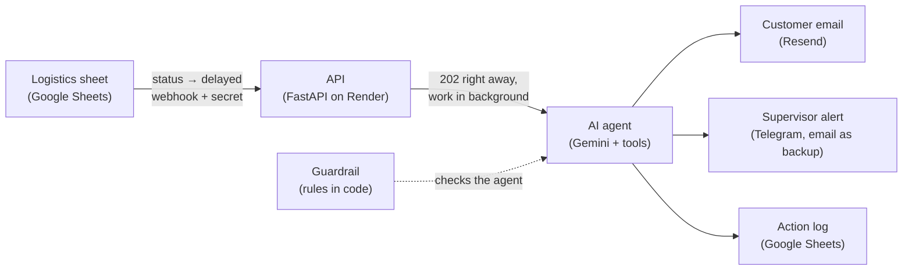

# Agente Logística — an AI worker for delayed shipments

**When a shipment is marked as delayed, an AI agent tells the customer, alerts a supervisor if the case needs a human, and logs every decision. In seconds, with no one at the keyboard.**

[Leer en español](README.es.md)

A personal project: I wanted to take an AI agent from idea to production, with real integrations, good engineering practices and a clear reason behind every decision.

---

## Demo

> Demo video: coming soon.

| 1. Someone marks a shipment as `retrasado` (delayed) in the logistics sheet | 2. The customer gets an email |
|---|---|
|  |  |

| 3. Serious case (stolen truck): the agent escalates with a draft instead of emailing | 4. Every action is logged |
|---|---|
|  |  |

What happens on the server, from the notice arriving to the agent finishing (real production logs):


## The problem

Picture a mid-sized logistics operator. When a shipment is delayed, someone in customer service has to notice it, look up the customer, write an email and, if the customer is important or the delay is serious, warn their supervisor. It is manual, slow and inconsistent: customers hear about it late (or never), every agent writes differently, and serious cases can slip through.

## The solution

An agent that reacts the moment a shipment becomes "delayed":

- **Reads** the shipment and customer data from the operator's system (a Google Sheet plays that role).
- **Decides** what to do based on business rules: inform the customer, escalate to a human, or both.
- **Writes** the customer email in the customer's language, without internal details and without inventing dates.
- **Escalates** to a supervisor on Telegram when the delay is long, the customer is high priority, the data is wrong, or something serious happened that the rules do not cover (for example, a stolen truck). In those cases it attaches a draft email so the human only has to review it.
- **Logs** every action, so every decision can be audited.

All the data is made up (fictional customers and shipments). Emails run in test mode and only reach my own inbox.

## How it works



**One notice, step by step** (shipment ENV-1001, 6-hour delay):

1. Someone changes the status to `retrasado`. A small script in the sheet (Apps Script) sends a webhook to the server with a shared secret and a unique `event_id`.
2. The server checks the secret, validates the body and checks it has not seen that `event_id` before. It answers `202` straight away, so the sheet does not wait for the agent.
3. In the background, the agent asks for the shipment data, applies the rules (6 hours, normal priority → email only, no escalation), writes the email and logs the action.
4. Before sending, the email tool asks the rules in code again: if the email should not go out, it refuses. The email carries an idempotency key, so the same notice can never send it twice.
5. When the agent finishes, a guardrail with no LLM compares what the agent did against the rules. If an escalation is missing, the code does it; if something does not add up, it is logged.

## Key decisions and why

- **The LLM decides, the code verifies.** The agent picks its tools with the rules in the prompt, and afterwards a guardrail in plain Python (`rules.py`, the single source of truth) checks the outcome. Flexibility from the model, guarantees from code. *"The prompt guides, the code guarantees."*
- **Prevent where it is irreversible, detect where it can be fixed.** An email cannot be unsent, so the email tool checks the rules *before* sending; a missing escalation or log can be fixed afterwards, so the guardrail handles it. In a test where the prompt was tampered with to "always send the email", the model tried, and the tool refused.
- **The model never writes identifiers.** The shipment ID and the recipient address are injected by the code. In an early test the model "corrected" an ID; now it simply cannot.
- **Judgment with a safety net.** For serious situations the rules do not cover (theft, lost goods, accidents), the agent escalates with a `JUDGMENT:` message and a draft instead of emailing. These cases are logged, so they can be measured and the ones that repeat can become rules.
- **Idempotency at two levels.** A webhook can arrive twice (retries, a server waking up). The server remembers each `event_id` in the sheet, which survives restarts, and every email carries an idempotency key. One notice → at most one email.
- **Answer fast, work in the background.** The agent takes seconds; whoever sends the notice should not wait or retry because of a timeout.
- **Fail closed when the action is irreversible.** No webhook secret → the server will not start. Real emails without a test recipient → the program stops. Cannot check for duplicates → `503`, and the agent does not run. Alerts are the opposite: they always go out, even if the rules cannot be checked, because an unowned case is worse than an extra alert.
- **Safe by default.** Emails and alerts are simulated unless you switch them on; sending to real customers needs an explicit flag that this project never sets.
- **Retries depend on the cost of a duplicate.** A customer email is never retried blindly (a duplicate is visible to the customer); a supervisor alert is retried once and has a second channel (email) if Telegram fails.
- **The sheet script remembers what it notified.** Google only gives the previous value of a cell when it is typed by hand, not when it is pasted. The script keeps its own record of which shipments it already reported, so pasting over a cell does not resend anything, and a genuine second delay still does.
- **Check the configuration at startup.** In the cloud there is no terminal: if something essential is missing, the new version does not start and the previous one keeps serving.

## Results

| Goal | Result |
|---|---|
| Works end to end in production, without my computer | Sheet → Render → agent → email, Telegram and log, for normal, escalated and "judgment" cases |
| Fast response | Under 10 s from notice to email with the server awake; about 30 s more when the free tier is waking up |
| No duplicates | The same notice twice → processed once (checked in production); pasting cells no longer resends |
| Safe with real services | Test mode that fails closed, rules checked before every email, idempotency keys |
| Testable without spending quota | ~80 automated checks with no LLM calls (fake Gemini, Telegram and Resend) |
| Understand every piece | Every phase closed by breaking something on purpose (predicting the result first) and answering review questions |

## Known limitations and next steps

- **Monitoring.** Telegram reports *cases*, not *outages*. Next: an external monitor on `/health`, alerts on `error` and `guardrail` rows in the log, on `429` quota errors and on notices that never reach `[agent] done`.
- **One agent at a time.** A lock keeps runs from mixing state. Next: isolate state per run and use a task queue with several workers.
- **Background work is lost on restart.** If the server restarts mid-run, that case is not retried ("at most once": a pending case is better than a duplicate email). Next: a persistent queue.
- **Webhook authentication.** A shared secret in a header. Next: an HMAC signature with a timestamp. A malformed JSON body gets a `422` even without the secret (FastAPI parses before the check); it reveals nothing and the agent never runs.
- **`/docs` is public in production, on purpose.** It only shows the shape of the API; without the secret every call gets `401`. Security comes from the secret, not from hiding the route.
- **Vague reasons.** A reason like "incident en route" is treated as a normal delay. Whether to escalate those is a business decision that should be made with data on how often they appear.
- **Full email verification.** If the agent sends an email and *then* spots something serious, the email is already out (it is logged). Next: hold every email, verify it, then send.
- **Free tier.** The Gemini daily quota is the real volume limit (there is a fallback chain of models); Render sleeps after 15 minutes; Resend without a domain only delivers to my own inbox. After reseeding the sheet, the sheet script's memory must be rebuilt by hand.

## What I learned

- **Guarantees cannot depend on the model.** Same model, same case, two runs, two different paths. Anything critical has to be enforced in code.
- **A system is more than the agent.** Webhooks, idempotency, secrets, retries, configuration and logs took more work, and taught me more, than the prompt.
- **Name the limits.** Knowing where a design breaks (and why that is acceptable for now) is part of the design.
- **Break it on purpose.** Predicting what will happen before breaking something, and then reading the real error, is the fastest way to understand a system.
- **Configuration comes from several places.** Knowing which one wins (environment variables over `.env`) saved me more than one confusing bug.

## Run it

You need Python 3.13 and a free Gemini API key. With the default settings the data lives in memory and nothing is actually sent.

```bash
python -m venv .venv
# Windows: .venv\Scripts\Activate.ps1   ·   macOS/Linux: source .venv/bin/activate
pip install -r requirements.txt
cp .env.example .env        # fill in GEMINI_API_KEY and GEMINI_MODEL
python -m app.agent ENV-1002              # one case through the agent + guardrail
python -m scripts.fase4_webhook checks    # webhook checks, no LLM calls
```

To run the API locally, add a `WEBHOOK_SECRET` (32+ characters) to `.env` and run `uvicorn app.main:app --reload`; the interactive docs are at `http://127.0.0.1:8000/docs`. Connecting the real services (Google Sheets, Resend, Telegram, Render) is explained step by step in the comments of [`.env.example`](.env.example) and in [`apps_script/webhook.gs`](apps_script/webhook.gs).

**Stack:** Python · FastAPI · Gemini (tool calling) · Google Sheets + Apps Script · Resend · Telegram · Render.

## Documentation

The design documents are in Spanish, in [`docs/`](docs/): context, architecture, phase plan, working method and data model. Lessons learned about the method are in [`docs/estado/lecciones.md`](docs/estado/lecciones.md).

## License

[MIT](LICENSE) © Sergio Tapia Jorge
