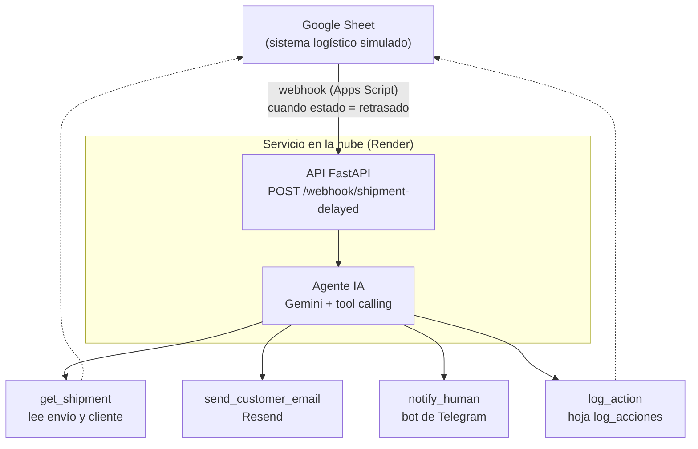

# Arquitectura

## Diagrama



## Flujo

1. Alguien cambia el `estado` de un envío a `retrasado` en la Google Sheet.
2. Un **Apps Script** (trigger `onEdit`) envía un **webhook** (POST con JSON) a la API, con un token secreto en la cabecera.
3. La **API** valida el token y el JSON y llama al agente con el `shipment_id`.
4. El **agente** (LLM con herramientas) decide los pasos: consulta el envío y el cliente, aplica las reglas de negocio, envía el email, escala si hace falta y registra la acción.
5. La API responde `200` con un resumen de lo que hizo.

## Componentes y stack

| Pieza | Tecnología | Papel |
|---|---|---|
| Lenguaje | Python 3.11+ | Todo el backend |
| API | FastAPI + Uvicorn | Recibe webhooks |
| LLM | Gemini API (modelo Flash, plan gratuito) vía SDK `google-genai` | Cerebro del agente con tool calling |
| Datos | Google Sheets + API (librería `gspread`, cuenta de servicio) | Simula el TMS/ERP del cliente |
| Disparador | Google Apps Script | Envía el webhook |
| Email | Resend (plan gratuito) | Comunicación con el cliente |
| Escalado | Bot de Telegram (API HTTP) | Aviso al responsable humano |
| Configuración | `python-dotenv` + `.env` | Secretos y ajustes |
| Despliegue | Render (web service gratuito) | Servicio público |
| Código | Git + GitHub | Versionado y revisión (rama + PR por fase) |

Todo es gratuito. Limitaciones conocidas: Render gratuito se "duerme" tras ~15 min sin uso (la primera petición tarda); Resend sin dominio propio solo envía al email propio; en el plan gratuito de Gemini, Google puede usar los datos, así que solo usamos datos inventados.

## Estructura de carpetas (objetivo)

```
Agente-logistica/
├── app/
│   ├── main.py            # API FastAPI (endpoints)
│   ├── agent.py           # Bucle del agente, prompt del sistema y guardarraíl
│   ├── tools.py           # Definición de las herramientas
│   ├── rules.py           # Reglas de negocio en código (única fuente de verdad; las usa el guardarraíl)
│   ├── mock_data.py       # Datos inventados en memoria (fase 2; en fase 3 los sustituye sheets.py)
│   ├── integrations/
│   │   ├── sheets.py      # Google Sheets
│   │   ├── email.py       # Resend
│   │   └── telegram.py    # Telegram
│   └── config.py          # Carga de variables de entorno
├── apps_script/
│   └── webhook.gs         # Código del trigger de la Sheet
├── scripts/               # Pruebas manuales por fase
├── docs/
│   ├── contexto/          # Diseño fijo (contexto del proyecto de Claude)
│   └── estado/            # Estado vivo: progreso.md y bitacora.md
├── .env.example
├── .gitignore
├── requirements.txt
└── README.md
```

## Decisiones de diseño (y por qué)

- **Google Sheets como "sistema del cliente":** gratis, visible y editable a mano para la demo; además obliga a hacer una integración real con API y autenticación.
- **Reglas de negocio en el prompt + herramientas pequeñas:** el LLM decide, pero cada acción pasa por una función controlada. Es el patrón habitual en agentes empresariales.
- **El LLM decide, el código verifica (guardarraíl):** al terminar el agente, `rules.py` dice qué debía pasar y se compara con lo que hizo y con lo que intentó. Si faltó un escalado, lo hace el código; si escaló de más, solo se registra (acción `guardrail` en el log). Nunca avisa dos veces al humano, y un fallo técnico de una herramienta es motivo legítimo de escalado, no un error del agente (sin falsos positivos que hagan ignorar el guardarraíl).
- **El modelo no escribe los identificadores:** el `shipment_id` lo inyecta el código en las herramientas (`make_tools`), por ejecución. Lo que el modelo no escribe no lo puede cambiar; y crear las herramientas por ejecución (no con una variable global) evita mezclar ids cuando la API atienda varias peticiones a la vez.
- **Criterio con red (regla 6):** ante algo grave que las reglas no prevén, el agente escala por criterio (`JUDGMENT:`) y no envía el email: el humano recibe un borrador y decide. Se registra para medirlo y lo que se repita pasa a `rules.py`.
- **Escalado a humano (human-in-the-loop):** en procesos reales el agente no lo resuelve todo; saber cuándo escalar es parte del diseño.
- **Token secreto en el webhook:** la API es pública; sin él cualquiera podría disparar el agente.
- **Registro de cada acción:** trazabilidad y auditoría, imprescindibles para que un cliente confíe en el agente.
