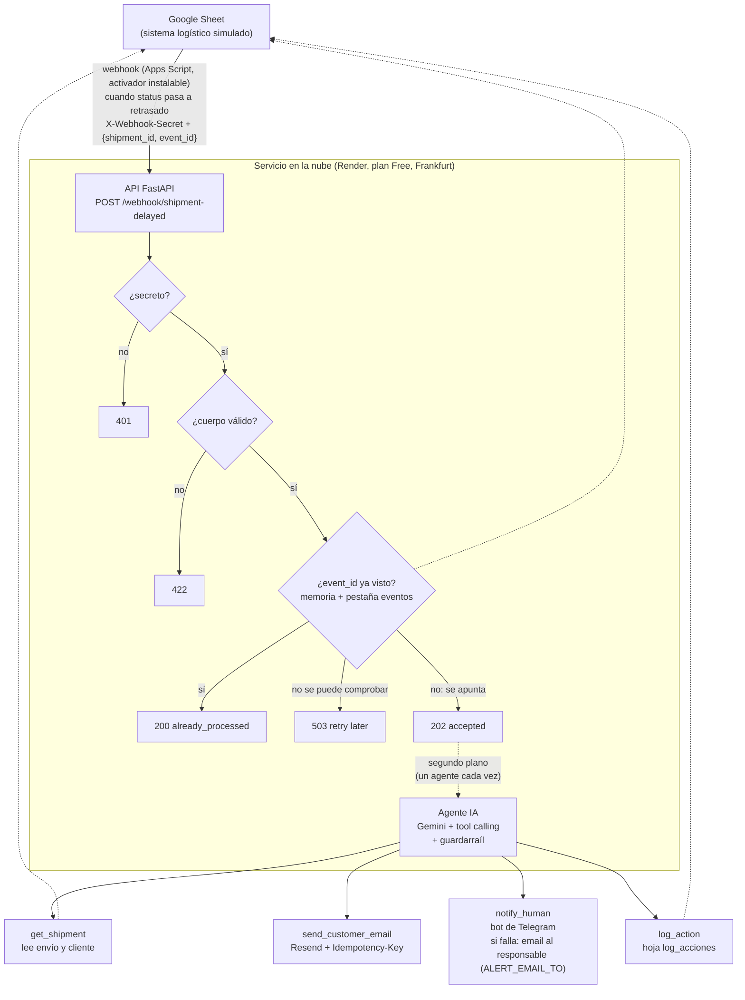

# Arquitectura

## Diagrama



## Flujo

1. Alguien cambia el `status` de un envío a `retrasado` en la Google Sheet.
2. Un **Apps Script** (`apps_script/webhook.gs`, activador **instalable**: el `onEdit` simple no puede llamar a URLs externas) envía un **webhook**: POST con JSON `{shipment_id, event_id}` y el secreto compartido en la cabecera `X-Webhook-Secret`. El `event_id` es único por cada cambio a `retrasado` y se reutiliza en los reintentos de ese mismo aviso.
3. La **API** comprueba, en este orden: el secreto (`compare_digest`; si falta o no coincide → `401`), el cuerpo con pydantic (→ `422`) y si el `event_id` ya llegó antes (→ `200 already_processed`, sin agente). Si no puede comprobarlo porque la hoja no responde → `503` y tampoco ejecuta el agente.
4. Si el aviso es nuevo, lo apunta en la pestaña `eventos` y responde **`202 accepted` al momento**: quien avisa no espera al agente (tarda segundos) ni reintenta por un timeout.
5. En **segundo plano** (`BackgroundTasks`, un agente cada vez), el **agente** (LLM con herramientas) consulta el envío y el cliente, aplica las reglas, envía el email (con clave de idempotencia de Resend derivada del `event_id`), escala si hace falta y registra la acción. Después, el **guardarraíl** comprueba que no falte nada. El resultado va a la hoja, al email y a Telegram, no a quien avisó. Si Telegram no entrega un aviso al responsable, el mismo aviso sale por email a `ALERT_EMAIL_TO` (segundo canal); si también falla, el guardarraíl reintenta una vez y deja una fila `error` en el log como último recurso.
6. Si la API no responde o devuelve `503`/5xx, el script de la hoja reintenta (hasta 3 veces, 5 s y 10 s) **con el mismo `event_id`**: reintentar es seguro porque la API es idempotente. Con `401`/`422` no reintenta (no se arreglaría solo).

## Componentes y stack

| Pieza | Tecnología | Papel |
|---|---|---|
| Lenguaje | Python 3.13 (fijado con `.python-version`, el mismo en local y en Render) | Todo el backend |
| API | FastAPI + Uvicorn | Recibe webhooks |
| LLM | Gemini API (modelo Flash, plan gratuito) vía SDK `google-genai` | Cerebro del agente con tool calling |
| Datos | Google Sheets + API (librería `gspread`, cuenta de servicio) | Simula el TMS/ERP del cliente |
| Disparador | Google Apps Script | Envía el webhook |
| Email | Resend (plan gratuito) | Comunicación con el cliente |
| Escalado | Bot de Telegram (API HTTP) + email de respaldo (Resend) | Aviso al responsable humano |
| Configuración | `.env` + `python-dotenv` en local; variables de entorno y archivo secreto en Render | Secretos y ajustes |
| Despliegue | Render (web service gratuito) | Servicio público |
| Código | Git + GitHub | Versionado y revisión (rama + PR por fase) |

Todo es gratuito. Limitaciones conocidas: Render gratuito se "duerme" tras ~15 min sin tráfico de fuera y tarda unos 50 s o más en despertar; tiene 750 h/mes por workspace, borra el disco al redesplegar, reiniciar o dormirse y puede reiniciar el servicio cuando quiera (un agente a medias se perdería: límite de `BackgroundTasks`); Resend sin dominio propio solo envía al email propio; en el plan gratuito de Gemini, Google puede usar los datos, así que solo usamos datos inventados; la cuota diaria de Gemini es el límite real de volumen (respaldo de modelos en cadena). En la hoja, **pegar** no da el valor anterior; el script guarda qué envíos ya avisó (Propiedades del documento), así que pegar el mismo estado no reenvía nada y un segundo retraso real sí avisa.

## Despliegue (Render)

- **Servicio:** web service del plan Free en Frankfurt (la región más cercana), conectado a GitHub con acceso **solo a este repo**. Build: `pip install -r requirements.txt`. Arranque: `uvicorn app.main:app --host 0.0.0.0 --port $PORT` (`0.0.0.0` acepta llamadas de fuera de la máquina, `127.0.0.1` solo de sí misma; el puerto lo da Render en `PORT`). Python fijado con `.python-version`. URL: `https://agente-logistica.onrender.com`.
- **Health check:** Render llama a `GET /health` cada pocos segundos desde su red interna; si deja de responder 200, lo da por caído. Esas llamadas no cuentan como tráfico y no impiden que se duerma.
- **Configuración:** en Render no hay `.env` (Git lo ignora). Las variables se ponen en el panel (**Environment**) y la clave JSON de la cuenta de servicio como **archivo secreto**, que Render deja en `/etc/secrets/service_account.json` (`GOOGLE_SERVICE_ACCOUNT_FILE` apunta ahí). Regla común a local y nube: gana lo que ya está en el entorno del proceso; `load_dotenv()` solo rellena huecos y nunca pisa. Por eso el `.env` local puede seguir en modo `simulated` y Render en modo real sin pisarse. `PYTHONUNBUFFERED=1` para que los `print` lleguen a los logs al momento.
- **Secretos por entorno:** el `WEBHOOK_SECRET` de producción es distinto del local; está en Render y en las Propiedades del script de la hoja. `EMAIL_ALLOW_REAL_RECIPIENTS` no se pone: el modo pruebas sigue cerrado en producción.
- **Comprobación al arrancar:** `config.startup_report()` revisa toda la configuración imprescindible (Gemini, hoja y archivo de la clave, Resend, Telegram) y escribe una línea `[startup] DATA_SOURCE=… key_file=found EMAIL_MODE=… NOTIFY_MODE=… ALERT_EMAIL_TO=set`, sin valores. Si falta algo, el servidor no arranca: el despliegue falla, el error se lee en los logs y Render mantiene la versión anterior.
- **Despliegue continuo:** Auto-Deploy "On Commit". Durante una fase, Render despliega la rama de la fase; al fusionar el PR, la rama de Render pasa a `main` y cada merge a `main` despliega.
- **Logs:** pestaña **Logs** de Render. Las líneas `==>` son de Render (build, arranque, `Exited with status 1`); las que llevan la etiqueta de la instancia son de nuestro código (`[startup]`, `[webhook]`, `[agent]`, `[EMAIL …]`, `[LOG]`, `[FALLBACK]`). Para diagnosticar: ir al final, buscar el primer error y leer las líneas de la instancia de alrededor; filtrar por `[agent]` o `webhook` quita el ruido de los health checks.

## Estructura de carpetas (objetivo)

```
Agente-logistica/
├── app/
│   ├── main.py            # API FastAPI: /health y el webhook (secreto, validación, 202 + agente en segundo plano)
│   ├── events.py          # Idempotencia del webhook: event_id ya recibidos (memoria + fuente de datos)
│   ├── agent.py           # Bucle del agente, prompt del sistema y guardarraíl
│   ├── tools.py           # Definición de las herramientas
│   ├── rules.py           # Reglas de negocio en código (única fuente de verdad; las usa el guardarraíl)
│   ├── mock_data.py       # Datos inventados en memoria (fuente "memory": pruebas rápidas sin cuota)
│   ├── data_source.py     # Elige la fuente de datos según DATA_SOURCE (memory | sheets)
│   ├── integrations/
│   │   ├── sheets.py      # Google Sheets (adaptador: mismas funciones que mock_data)
│   │   ├── email.py       # Resend
│   │   └── telegram.py    # Telegram
│   └── config.py          # Carga de variables de entorno
├── apps_script/
│   └── webhook.gs         # Código del trigger de la Sheet
├── scripts/               # Herramientas de desarrollo: pruebas manuales por fase y seed_sheet.py (no se ejecutan en producción)
├── docs/
│   ├── contexto/          # Diseño fijo (contexto del proyecto de Claude)
│   └── estado/            # Estado vivo: lecciones.md (progreso, bitácora y próximo encargo: solo en local)
├── .env.example
├── .gitignore
├── .python-version        # Versión de Python que usa Render (la misma que en local)
├── requirements.txt
└── README.md
```

## Decisiones de diseño (y por qué)

- **Google Sheets como "sistema del cliente":** gratis, visible y editable a mano para la demo; además obliga a hacer una integración real con API y autenticación.
- **Patrón adaptador para los datos del cliente:** `mock_data.py` e `integrations/sheets.py` ofrecen las mismas funciones (`find_shipment`, `find_customer`, `append_log` y, para el webhook, `find_event`, `append_event`) con la misma forma de datos, y `DATA_SOURCE` en `.env` elige cuál usar sin tocar código. Las herramientas, el agente y `rules.py` no saben de dónde vienen los datos: otro sistema (un ERP, una base de datos) solo necesita su propio adaptador. El adaptador **traduce, no decide**: convierte el texto de la hoja a tipos y, si un valor no se puede convertir, lo pasa tal cual para que `rules.py` lo marque como dato incoherente.
- **Acceso mínimo a la hoja:** la cuenta de servicio no tiene roles en el proyecto de Google Cloud, solo acceso de editor a esta hoja, y su token solo pide el permiso de hojas de cálculo. La clave JSON nunca va a Git.
- **Fallos del sistema del cliente sin tumbar el servicio:** si la hoja no responde, el error llega al agente como fallo técnico, el guardarraíl escala desde el código si nadie lo hizo, y una fila de log solo cuenta como guardada si la hoja la aceptó.
- **Reglas de negocio en el prompt + herramientas pequeñas:** el LLM decide, pero cada acción pasa por una función controlada. Es el patrón habitual en agentes empresariales.
- **El LLM decide, el código verifica (guardarraíl):** al terminar el agente, `rules.py` dice qué debía pasar y se compara con lo que hizo y con lo que intentó. Si faltó un escalado, lo hace el código; si escaló de más, solo se registra (acción `guardrail` en el log). Nunca avisa dos veces al humano, y un fallo técnico de una herramienta es motivo legítimo de escalado, no un error del agente (sin falsos positivos que hagan ignorar el guardarraíl).
- **El modelo no escribe los identificadores:** el `shipment_id` lo inyecta el código en las herramientas (`make_tools`), por ejecución. Lo que el modelo no escribe no lo puede cambiar; y crear las herramientas por ejecución (no con una variable global) evita mezclar ids cuando la API atienda varias peticiones a la vez.
- **Criterio con red (regla 6):** ante algo grave que las reglas no prevén, el agente escala por criterio (`JUDGMENT:`) y no envía el email: el humano recibe un borrador y decide. Se registra para medirlo y lo que se repita pasa a `rules.py`.
- **Escalado a humano (human-in-the-loop):** en procesos reales el agente no lo resuelve todo; saber cuándo escalar es parte del diseño.
- **Secreto compartido en el webhook:** la API es pública; sin él cualquiera podría disparar el agente (y hacer que envíe emails). Se compara con `secrets.compare_digest` (tiempo constante: el tiempo de respuesta no revela cuánto acertó un atacante) y se comprueba **antes** que el cuerpo (dependencia de FastAPI), para no dar pistas de la forma del aviso; solo un JSON mal formado da `422` sin secreto, porque FastAPI lo lee antes. Sin `WEBHOOK_SECRET` (o con menos de 32 caracteres) el servidor no arranca: falla cerrado. En la hoja, el secreto va en las Propiedades del script, nunca en el código.
- **Webhook (push) en vez de consultas periódicas (pull):** el sistema del cliente avisa cuando pasa algo; nadie tiene que preguntar "¿hay algo nuevo?" cada cierto tiempo.
- **Responder 202 y trabajar en segundo plano:** el agente tarda segundos; si quien avisa esperara, podría cansarse y reenviar el aviso. Los agentes se ejecutan **de uno en uno** (candado) porque la "bandeja de salida" de `tools.py` es compartida. Suficiente para este volumen; en producción, una cola de tareas. Limitación: si el servicio se reinicia a mitad, ese trabajo se pierde.
- **Idempotencia en dos niveles:** un aviso puede llegar dos veces (reintentos, el servicio despertando en Render). (1) La API no procesa dos veces el mismo `event_id`: lo busca en memoria (frena dos avisos idénticos a la vez) y en la pestaña `eventos` (sobrevive a los reinicios de Render; la memoria y el disco se borran); con `DATA_SOURCE=memory`, solo memoria. Se apunta **al recibirlo**: como mucho una vez; si el agente falla a mitad, un reintento no lo repite y lo revisa un humano (un email duplicado es peor que un caso pendiente). (2) El email lleva `Idempotency-Key: shipment-delayed/<event_id>`: Resend no reenvía la misma clave en 24 h (y con otro contenido da `409` y no envía). Cubre lo que (1) no ve: el modelo llamando dos veces a la herramienta o un reproceso manual.
- **El script de la hoja recuerda qué avisó:** Google solo da el valor anterior de una celda al escribirla a mano, no al pegar. En vez de depender de ese dato, `webhook.gs` guarda una marca por envío (`notified:<shipment_id>`) en las Propiedades del documento: "retrasado" sin marca avisa, con marca no hace nada y cualquier otro estado la borra (un segundo retraso real vuelve a avisar). La marca se pone dentro de un candado antes de enviar y se quita si el servidor no acepta el aviso, para poder reintentarlo.
- **Ante la duda, no actuar (503):** si la hoja no responde no se puede saber si el aviso está repetido; mejor tarde (quien avisa reintenta) que un email duplicado.
- **Registro de cada acción:** trazabilidad y auditoría, imprescindibles para que un cliente confíe en el agente.
- **Dos canales para avisar al humano:** si Telegram falla, `deliver_alert` (el único punto por el que pasan todos los avisos, del agente y del guardarraíl) envía el mismo aviso por email a `ALERT_EMAIL_TO`. El log solo no basta como respaldo: nadie lo mira. El email de aviso no cuenta como email al cliente (el guardarraíl no lo confunde) y no lleva clave de idempotencia (un aviso duplicado es una molestia, no un daño). Cada uso del respaldo deja una fila `guardrail` para medir cuánto falla Telegram.
- **Comprobar la configuración al arrancar:** en la nube no hay terminal; un fallo de configuración debe verse en el despliegue, no con el primer aviso de un cliente. Falla cerrado, como el secreto del webhook.
- **Un secreto por entorno:** si se filtra el de pruebas, la URL pública no queda abierta.
